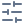

#  UrbanHub - Jumeau Numérique & Plateforme Data Lake Smart City

> **Projet M2 IPSSI** - Architecture Data Lake & Entrepôts de Données  
> Système Big Data pour la collecte, le stockage et l'analyse croisée de données urbaines (Batch, Streaming, IoT).

---

##  Sommaire

1. [Présentation du projet](#présentation-du-projet)
2. [Architecture du Data Lake](#architecture-du-data-lake)
3. [Organisation du Répertoire](#organisation-du-répertoire)
4. [Sources de Données & Périmètre](#sources-de-données--périmètre)
5. [Prérequis & État de l'Environnement](#prérequis--état-de-lenvironnement)
6. [Guide de Démarrage Rapide](#guide-de-démarrage-rapide)
7. [Documentation & Suivi](#documentation--suivi)
8. [Livrables Attendus](#livrables-attendus)

---

##  Présentation du projet

Une **Smart City** moderne génère en continu d'importants volumes de données hétérogènes :
- Capteurs environnementaux et qualité de l'air (IoT)
- Observations météorologiques historiques et actuelles (Batch)
- Réseaux de transport et mobilités douces en libre-service (Streaming)

**UrbanHub** est un jumeau numérique urbain capable d'ingérer ces flux, d'assurer leur gouvernance au sein d'un **Data Lake structuré en architecture médaillon (Bronze ➔ Silver ➔ Gold)**, et de croiser ces données pour éclairer la prise de décision publique.

---

##  Architecture du Data Lake

Le système s'articule autour de trois couches de stockage et de raffinage de données :

```text
       SOURCES                          DATA LAKE                            RESTITUTION
 ┌──────────────────┐
 │ NOAA Météo       │──(Batch)────┐
 └──────────────────┘             │
 ┌──────────────────┐             ▼
 │ CityBikes Vélos  │──(Stream)──►[ BRONZE ]  Données brutes horodatées (CSV / JSON)
 └──────────────────┘             │
 ┌──────────────────┐             ▼
 │ OpenAQ Pollution │──(IoT)─────►[ SILVER ]  Tables nettoyées, typées, dédupliquées (Parquet)
 └──────────────────┘             │
                                  ▼
                                  [  GOLD  ]  Indicateurs agrégés & tables croisées
                                  │
                                  ▼
                         [ Dashboard Voilà ]  Visualisations & KPI interactifs
```

- ** Bronze :** Stockage brut des payloads API et fichiers sources avec métadonnées d'ingestion (S3 / MinIO).
- ** Silver :** Format Parquet colonnaire optimisé, schéma strict, timestamps unifiés en UTC, conversions d'unités et déduplication.
- ** Gold :** Vues décisionnelles agrégées par ville et heure (`weather_daily`, `mobility_station_latest`, `pollution_hourly`, `city_hourly`).

---

##  Organisation du Répertoire

```text
UrbanHub/
├── docs/                                  # Documentation projet & suivi
│   ├── ENONCE.md                          # Cahier des charges et consignes détaillées
│   ├── PLAN.md                            # Feuille de route chronologique et rôles
│   ├── AVANCEMENT.md                      # Journal de bord et checklist de progression
│   └── GUIDE_TECHNIQUE.md                 # Recettes, patterns de code et capitalisation des TPs
├── config/                                # Fichiers de configuration
│   └── cities.yml                         # Référentiel des villes et métadonnées
├── notebooks/                             # Notebooks d'ingestion et d'analyse
│   ├── 01_noaa_batch.ipynb                # Ingestion Batch NOAA France (5 ans)
│   ├── 02_citybikes_stream.ipynb          # Micro-batch CityBikes (toutes les 2-3 min)
│   ├── 03_openaq_iot.ipynb                # Ingestion IoT OpenAQ v3 (capteurs)
│   ├── 04_traitement_kpis.ipynb           # Pipelines de transformation Silver ➔ Gold
│   └── 05_dashboard.ipynb                 # Tableau de bord interactif Voilà
├── demos/                                 # Enregistrements vidéo finaux
│   ├── Démo-UrbanHub-Partie1.mp4          # Batch NOAA, Data Lake et vue météo
│   └── Démo-UrbanHub-Partie2.mp4          # Streaming, IoT, croisements et Dashboard
├── requirements.txt                       # Dépendances Python du projet
├── .env.example                           # Modèle de configuration d'environnement
└── README.md                              # Guide principal du projet (ce fichier)
```

---

##  Sources de Données & Périmètre

### 1. Flux Batch — Météo Open-Meteo

**Source officielle :** [Open-Meteo Historical Weather API](https://open-meteo.com/en/docs/historical-weather-api), modèle ECMWF IFS, données modélisées aux coordonnées de **Paris, Lyon et Lille**. Le lot va du 1er janvier 2020 à la dernière heure UTC terminée à l’exécution ; il ne représente pas un ensemble de stations couvrant toute la France. La visibilité est nulle au sens SQL quand l’API ne la fournit pas (notamment en 2020–2024). La pluie liquide en mm est alignée sur le début de l’intervalle d’accumulation d’une heure.

```bash
python scripts/openmeteo_batch.py           # lot local
python scripts/openmeteo_batch.py --upload  # actualisation des tables partagées R2
```

- Bronze : `openmeteo/year=AAAA/city_id=VILLE/archive.json` et `openmeteo/manifest.json`.
- Silver : `weather/openmeteo/year=AAAA/weather_hourly.parquet`.
- Gold : `kpis/weather_hourly.parquet` sur `(city_id, hour_utc)` en UTC ; `kpis/weather_daily.parquet` sur `(city_id, day_utc)` en UTC. Le rafraîchissement météo n’est pas planifié automatiquement.
- Analyse : [notebook Open-Meteo](notebooks/01_openmeteo_batch.ipynb). Sources à créditer : Open-Meteo et ECMWF IFS.

#### Ancien flux — archive NOAA ISD
- **Source :** [Archive NOAA ISD Global Hourly (NODD)](https://registry.opendata.aws/noaa-global-hourly/).
- **Périmètre :** Stations françaises (`CTRY=FR`) sur les cinq dernières années civiles complètes de l’archive ISD : 2020–2024. L’archive s’arrête le 24 août 2025 ; pour un croisement avec les collectes actuelles, utiliser [GHCNh](https://www.ncei.noaa.gov/products/global-historical-climatology-network-hourly).
- **Variables :** `station_id`, `timestamp`, `temperature`, `wind_speed`, `wind_direction`, `pressure`, `precipitation`, `visibility`.
- **Enjeux métier :** Détection d'anomalies climatiques, corrélations météo-visibilité, saisonnalité.

Depuis la racine, avec les dépendances du projet installées :

```bash
# Échantillon 2025 : Paris-Orly, Lyon–Saint-Exupéry et Lille–Lesquin
python scripts/noaa_batch.py --workers 3
# Lot France : cinq années civiles complètes, 2020–2024
python scripts/noaa_batch.py --mode france --workers 8
```

Le script reprend les CSV déjà téléchargés et distingue les fichiers absents (HTTP 404) des erreurs dans `bronze/noaa/manifest.json`. Les sorties sont sous `data/noaa-<mode>-<début>-<fin>/`. Avec `--upload`, le Gold du lot France est archivé sous `kpis/noaa/` ; l’échantillon utilise le préfixe `sample/2025-2025/`. L’analyse historique est dans [le notebook NOAA](notebooks/01_noaa_batch.ipynb).

Le [bilan du lot France 2020–2024](docs/RESULTATS_NOAA.md) recense les livrables déjà publiés et vérifiés sur R2, les conclusions météo et la limite des mesures de pluie.

### 2. Flux Streaming — Mobilité CityBikes
- **Source :** [CityBikes API](http://api.citybik.es/v2/networks)
- **Fréquence :** Collecte automatisée toutes les 2 à 3 minutes.
- **Variables :** `station_id`, `station_name`, `latitude`, `longitude`, `bikes_available`, `free_slots`, `timestamp`.
- **Enjeux métier :** Pression sur les stations, détection des ruptures de stock / saturations, pics journaliers.

### 3. Flux IoT - Pollution atmosphérique OpenAQ
- **Source :** [OpenAQ API v3](https://api.openaq.org/)
- **Polluants ciblés :** `PM2.5`, `PM10`, `NO2`, `O3`, `CO`.
- **Variables :** `sensor_id`, `latitude`, `longitude`, `pollutant`, `value`, `unit`, `timestamp`.
- **Enjeux métier :** Identification des points chauds, variations diurnes, profils d'émissions.

### 4. Analyses Croisées
- Alignement temporel sur l'heure UTC par agglomération.
- Interaction météo / qualité de l'air (dispersion, vent, pluie).
- Impact des intempéries sur l'usage des mobilités douces.

---

##  Prérequis & État de l'Environnement

L'infrastructure a été auditée et validée sous **Windows 11** :

- **Stockage S3 / MinIO (Silo) :**
  - Conteneur Docker `silo3` opérationnel sur le port `9000` (API S3) et `9001` (Console Web).
  - Identifiants : utilisateur `minioadmin` / mot de passe `minioadmin123`.
- **Gestionnaire d'environnement Python (`uv`) :**
  - Gestion par `uv` (version 0.11+).
  - Runtime recommandé : Python 3.11 (`uv run --python 3.11`).
- **Connectivité API :**
  - `CityBikes API` : Opérationnelle (HTTP 200).
  - `NOAA ISD` : CSV historiques disponibles via le miroir NODD ; les observations s’arrêtent le 24 août 2025.
  - `OpenAQ API` : Version 3 active ; nécessite l'obtention d'une clé API gratuite configurée dans `OPENAQ_API_KEY`.

---

##  Guide de Démarrage Rapide

### 1. Naviguer dans le dossier du projet
```powershell
cd UrbanHub
```

### 2. Lancer le stockage MinIO local (si non démarré)
Depuis la racine du dépôt principal :
```powershell
docker-compose up -d
```
> La console MinIO est ensuite accessible sur [http://localhost:9001](http://localhost:9001).

### 3. Installer les dépendances avec `uv`
```powershell
uv pip install -r requirements.txt
```

### 4. Configurer les variables d'environnement
Créer un fichier `.env` basé sur `.env.example` :
```ini
MINIO_ENDPOINT=localhost:9000
MINIO_ACCESS_KEY=minioadmin
MINIO_SECRET_KEY=minioadmin123
MINIO_BUCKET=urbanhub
OPENAQ_API_KEY=votre_cle_api_openaq
```

### 5. Lancer l'environnement de travail
```powershell
uv run jupyter notebook
```

---

##  Documentation & Suivi

-  [Cahier des charges complet (ENONCE.md)](docs/ENONCE.md)
-  [Feuille de route & Plan d'architecture (PLAN.md)](docs/PLAN.md)
-  [Tableau de bord de l'avancement (AVANCEMENT.md)](docs/AVANCEMENT.md)
-  [Guide Technique & Recettes d'Architecture (GUIDE_TECHNIQUE.md)](docs/GUIDE_TECHNIQUE.md)
-  [Guide Data Lake Cloud & Bascule R2 (DATALAKE_CLOUD_GUIDE.md)](docs/DATALAKE_CLOUD_GUIDE.md)

---

##  Livrables Attendus

1. **Scripts d'ingestion & pipelines :** Code modulaire et documenté pour les 3 flux.
2. **Stockage structuré :** Données partitionnées dans MinIO (Bronze ➔ Silver ➔ Gold).
3. **Analyses exploratoires & visualisations :** Notebooks avec graphiques et interprétations métier rigoureuses.
4. **Vidéos de démonstration :**
   - `demos/Démo-UrbanHub-Partie1.mp4` (Ingestion batch NOAA & Data Lake)
   - `demos/Démo-UrbanHub-Partie2.mp4` (Flux continus CityBikes/OpenAQ, analyses croisées & dashboard)
